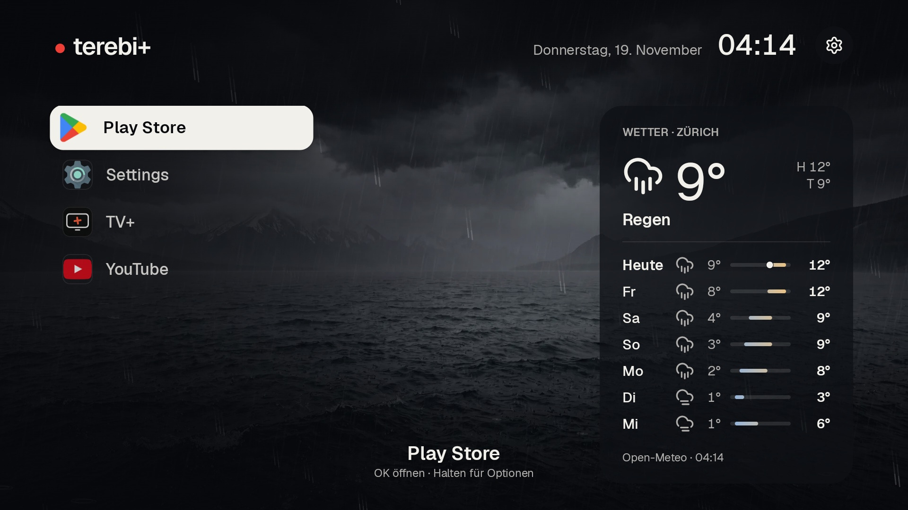
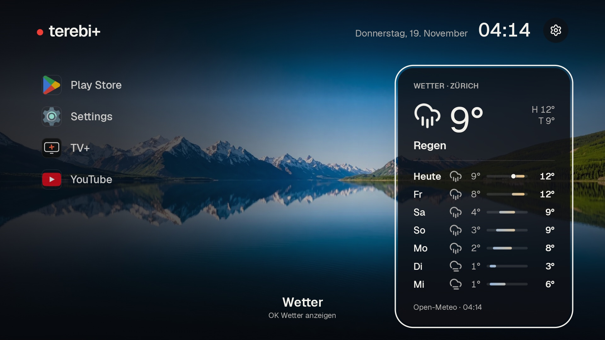
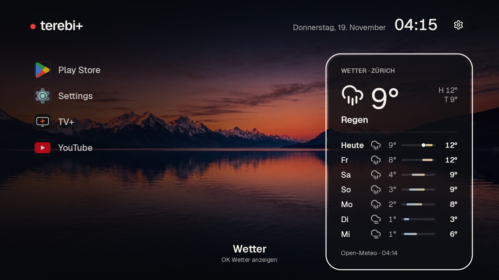
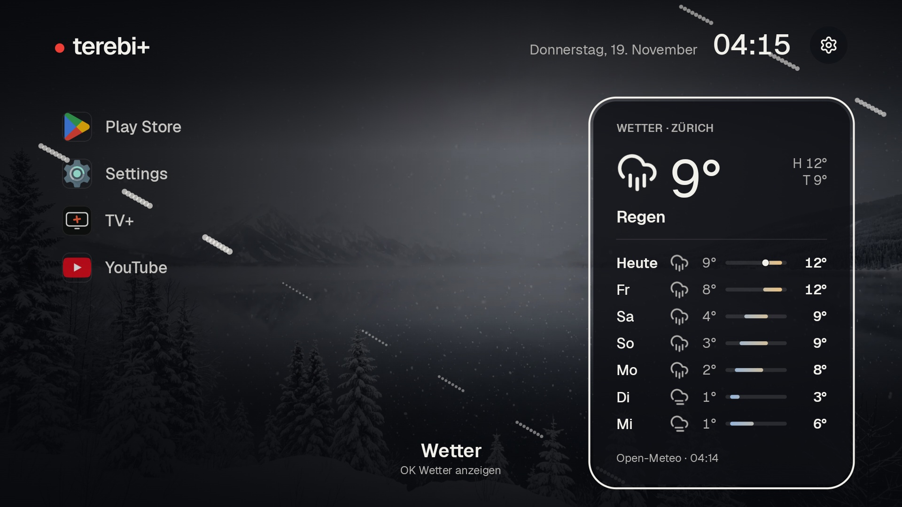
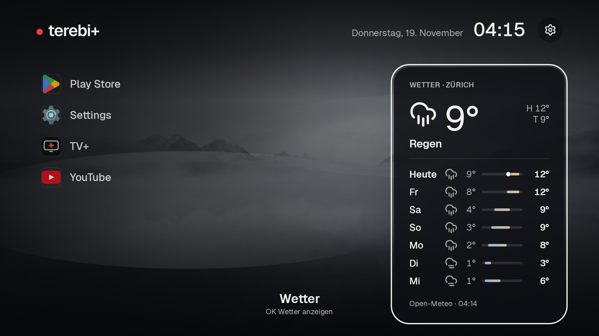
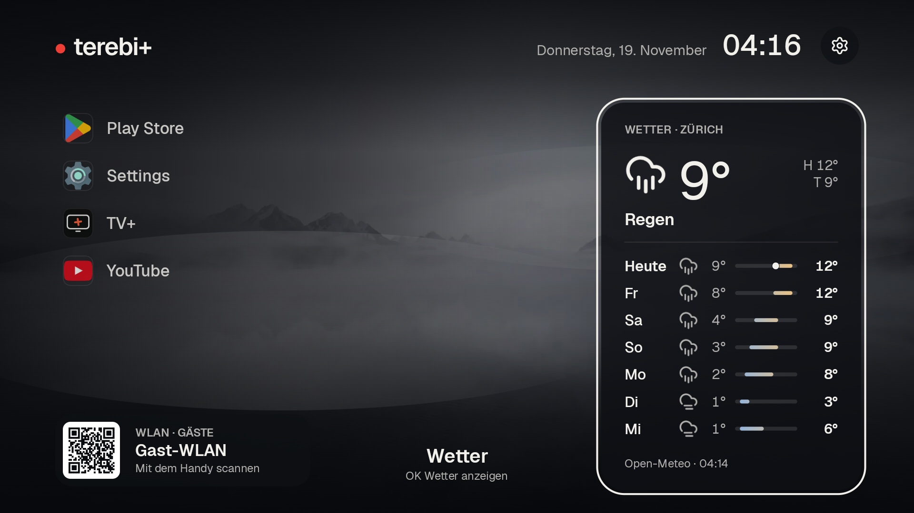
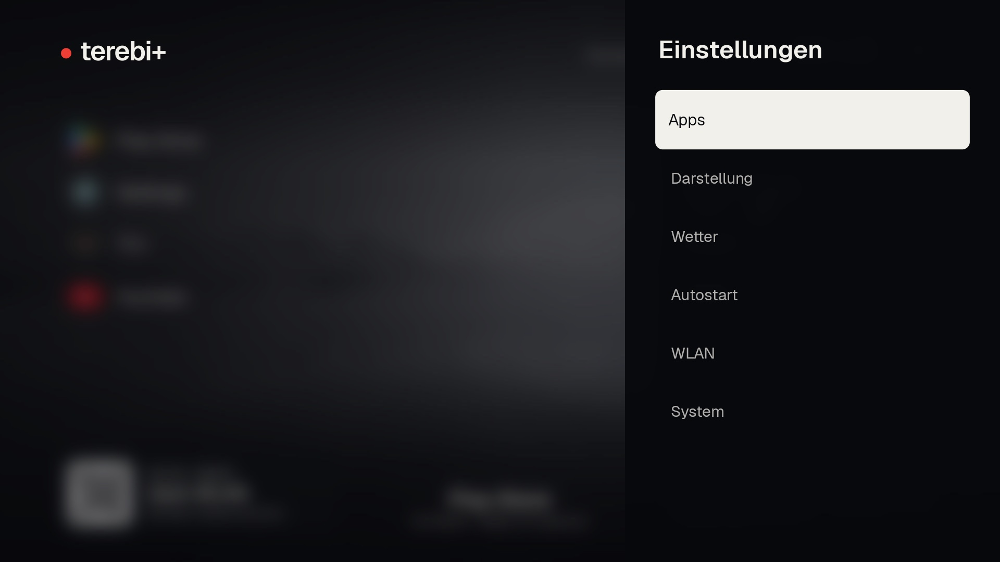
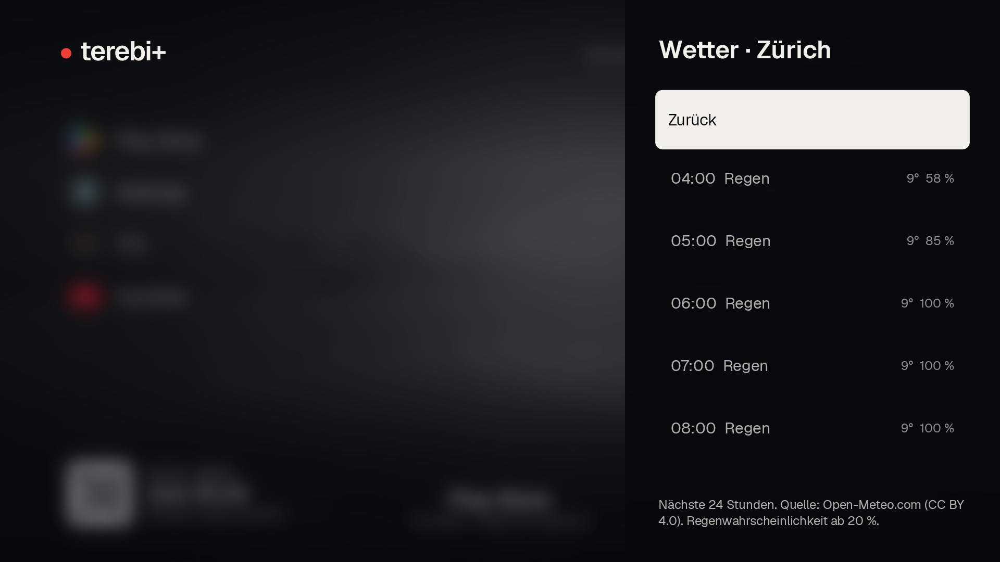

<p align="center">
  
</p>

# terebi+

Minimalistischer Launcher für Google TV und Android TV. Kotlin, Jetpack Compose, offline startfähig,
ohne Konto, Werbung oder Tracking. Wetter von Open-Meteo.com (CC BY 4.0).

## Screenshots

Aufgenommen im Google-TV-Emulator (Android 14, 1920 × 1080) mit Demo-Daten. In den Aufnahmen 2 bis 5 ist der Hintergrund von Hand gewählt, die Wetterkarte zeigt weiter das echte Wetter.

| | |
|---|---|
|  |  |
| Startseite bei Regen in der Nacht, aktives Wetter | Sonniger Morgen |
|  |  |
| Sonnenuntergang | Schneefall |
|  |  |
| Nebel | WLAN-Karte mit QR-Code (Demo-Netz) |
|  |  |
| Einstellungen als rechtes Overlay | Wetter-Detail mit Stundenwerten |

## Funktionen

- Apps im Zentrum (einspaltige Liste, Reihenfolge, Favoriten, Ausblenden), Uhr und Datum, Wetterkarte mit sieben Tagen.
- Aktives Wetter: Hintergrund und Effekte (Regen, Schnee, Nebel, Wolken, Blitze) nach Wetter und Tageszeit in Zürich, ohne Verbindung bleiben die letzten Daten.
- Autostart einer App nach dem Einschalten, WLAN-QR für Gäste (Passwort verschlüsselt im Android Keystore), Einstellungen komplett per Fernbedienung.
- Nur die Berechtigungen `INTERNET` und `REQUEST_INSTALL_PACKAGES` (nur für die Installation von IP Television+ über den Android-Installer).

## Schnellstart

```bash
# Vorschau im Browser (nur localhost)
npm --prefix preview install
npm --prefix preview run dev          # http://localhost:5173

# Native App
export JAVA_HOME=/opt/homebrew/opt/openjdk@21
./gradlew :app:testDebugUnitTest :app:assembleRelease
# APK: app/build/outputs/apk/release/app-release.apk (ohne Umgebungsvariablen mit dem Debug-Schlüssel signiert, nur zum Testen; eigener Release-Schlüssel über `TEREBI_KEYSTORE` und `TEREBI_KEYSTORE_PASSWORD`)
```

`local.properties` (nicht im Repo): `sdk.dir=/opt/homebrew/share/android-commandlinetools`

## Bedienung

| Taste | Wirkung |
|---|---|
| Pfeile | Fokus bewegen |
| OK | App starten / Eintrag wählen |
| OK lang | App-Optionen (ausblenden, Favorit, verschieben, App-Info) |
| Zurück | Ebene schliessen; auf der Startseite ohne Wirkung |
| Home | alles schliessen, Fokus auf erste App |
| Menü oder Zahnrad oben rechts | Einstellungen |

## Dokumentation

- `docs/installation.md` Installation, Standard-Launcher, Wiederherstellung
- `docs/preview.md` Was die Vorschau simuliert und was nur auf Android prüfbar ist
- `docs/state-model.md` Gemeinsames Zustandsmodell
- `TASKS.md` Stand und Definition of Done · `DECISIONS.md` Entscheidungen

## Lizenzen und Rechte

- Schriften: Geist und Geist Mono (SIL OFL 1.1, `assets/fonts/OFL.txt`); Inter nur in der Vorschau (OFL 1.1).
- Symbole: Lucide (ISC). Bibliotheken: ZXing (Apache 2.0), qrcode (MIT). Wetterdaten: Open-Meteo (CC BY 4.0).
- Hintergrundfoto `lake-mcdonald.webp`: National Park Service / Jacob W. Frank, Public Domain (`assets/backgrounds/LICENSES.md`).
- **Szenenbilder** (`assets/backgrounds/scene_*.webp`, Originale in `design-src/scenes/`): vom Projektinhaber geliefert, Herkunft und Nutzungsrechte nicht dokumentiert. Nicht zur Wiederverwendung freigegeben.
- `assets/bundled/iptelevision-1.2.0.apk`: IP Television+ des Projektinhabers (signiertes Release).
- Quellcode: noch keine Lizenzdatei gewählt, damit gelten alle Rechte beim Projektinhaber, bis eine Lizenz hinzugefügt wird.
